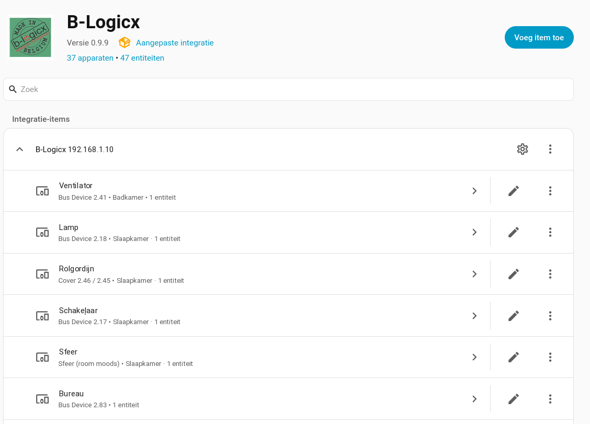

# B-Logicx for Home Assistant

[Nederlands](README.md) | **English**

Custom integration that connects [Home Assistant](https://www.home-assistant.io/) directly to a **[B-Logicx](https://b-logicx.be/) [NWM](https://b-logicx.be/DataSheet/DS_NWM.pdf) / NWX** bus gateway — the [BHS](https://b-logicx.be/DataSheet/DS_BHS.pdf) Home Server is optional and not a requirement.

**This integration's website:** [b-logicx.rafverbiest.be/en.html](https://b-logicx.rafverbiest.be/en.html)

## Features

- Switches (**[RLM](https://b-logicx.be/DataSheet/DS_RLM.pdf)** / **SoftM**), **dimmers**, and **read-only** addresses (generic Set/Reset)
- **[Covers](https://b-logicx.be/DataSheet/DS_Rolluik.pdf)** (dual RLM) and **Sfeer** selection
- **SoftM** virtual status module (VSM) inside Home Assistant
- **TCP bus repeater** — share the single [NWM](https://b-logicx.be/DataSheet/DS_NWM.pdf) link with [BLConfig](https://b-logicx.be/Manual/BLConfig/HTML/Introductie.html) / blxmonitor
- **[RTC](https://b-logicx.be/DataSheet/DS_RTC.pdf)** sync (incl. DST), **[LDM](https://b-logicx.be/DataSheet/DS_LDM.pdf)** light sensor, **[TSM](https://b-logicx.be/DataSheet/DS_TSM.pdf)** thermostat, **[WSM](https://b-logicx.be/DataSheet/DS_WSM.pdf)** wind speed (km/h), **[BM8](https://b-logicx.be/DataSheet/DS_BM8.pdf)** doorbell
- **AUD** media players: sources, volume and mute. Tested with a NuVoP through BHS, and with Spotify through Home Assistant.
- **Import** addresses from YAML (import and export), or once from the BHS member list or from a BLConfig database (FDB). BHS and FDB are experimental; you check what to add. The FDB file is read and not stored.



## About this project

[B-Logicx](https://b-logicx.be/) is a Belgian home-automation vendor (Heist-op-den-Berg). Their bus uses EIB/KNX cabling and 24 V DC (black = 0, red = +24 V, yellow = bus signal). The system is decentralised by nature and makes it easy to spread the building blocks (inputs and outputs) through a building. An important advantage of B-Logicx is that everything is powered over the bus, and that (within certain limits) a single 24 V supply is enough. The protocol is simple: each datagram is **two bytes** (command + group, address).

### Later installations

The problem I have found more and more over recent years is that newer, usually wireless, home-automation products make classic systems such as B-Logicx or Niko Home Control feel dated, because installation is simple. Wireless products do have the drawback that they often run on batteries, but they are much easier to fit, often without much experience, which makes them especially attractive for later installations.

### Hybrid

This project means you do not have to choose: it lets an existing system become a **hybrid**. By letting B-Logicx talk to Home Assistant, it lets you install Zigbee, Z-Wave or Shelly where that makes the installation much simpler, without that becoming a second, parallel system beside the existing B-Logicx.

The official B-Logicx way to connect to Home Assistant is too limited, and it also requires a B-Logicx Home Server.

This integration works **only through a network module** that every system already has, and it provides seamless, real-time communication between B-Logicx and Home Assistant.

## Links

- [**This integration's website**](https://b-logicx.rafverbiest.be/en.html)
- [**B-Logicx**](https://b-logicx.be/) — the manufacturer's website
- [**Releases**](https://github.com/rafverbiest/homeassistant_b-logicx/releases)

## Documentation

[Installation](https://b-logicx.rafverbiest.be/Installation.html) ·
[Configuration](https://b-logicx.rafverbiest.be/Configuration.html) ·
[Dimmer](https://b-logicx.rafverbiest.be/Dimmer-en.html) ·
[SoftM](https://b-logicx.rafverbiest.be/SoftM-en.html) ·
[Bus repeater](https://b-logicx.rafverbiest.be/Bus-repeater-en.html) ·
[Diagnostics](https://b-logicx.rafverbiest.be/Diagnostics.html) ·
[YAML](https://b-logicx.rafverbiest.be/YAML-en.html) ·
[B-Logicx upgrades](https://b-logicx.rafverbiest.be/Alternatives.html)

## Important

This integration was produced independently. I am **not** affiliated with [B-Logicx](https://b-logicx.be/).
**[BLConfig](https://b-logicx.be/Manual/BLConfig/HTML/Introductie.html)** remains required to program hardware; this HA integration monitors and controls the bus after it is configured.

## Author

I built this originally for my own use, and to help keep B-Logicx from becoming obsolete as newer systems appear.

In my view Home Assistant is the engine of *The Internet of Things*; things that do not integrate with it (well) will disappear over time.

I manage a large number of buildings where B-Logicx is installed; for me this is how those buildings avoid having to be refitted with other home-automation systems anytime soon.

I put the code online to help make B-Logicx more future-proof, and to get in touch with other B-Logicx users. How widespread is this system? Let me know!

If this project helps you (or something is not working), feel free to email me: raf.verbiest@gmail.com

## Install

Search for **B-Logicx** in HACS (or in the Marketplace on Home Assistant 2026.11 or newer) and choose **Download**. Restart Home Assistant. Then add the integration via **Settings → Devices & services → Add integration → B-Logicx** and enter the gateway IP (default port `10001`).

### Other ways

If it is not listed yet, add the repository via **HACS** → top-right **⋮** → **Custom repositories**, category **Integration**:

```text
https://github.com/rafverbiest/homeassistant_b-logicx
```

By hand: copy `custom_components/b_logicx` into `config/custom_components/`, restart, and add the integration as above.

## License

See [LICENSE](https://github.com/rafverbiest/homeassistant_b-logicx/blob/main/LICENSE) in the repository.

## Development

```bash
python3 -m venv .venv
source .venv/bin/activate
pip install -r requirements-dev.txt
pytest
```

See `TESTS.md`, `RELEASING.md`, and `TRANSLATIONS.md`.
