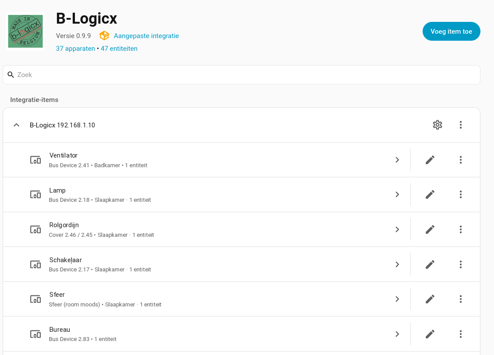

# B-Logicx voor Home Assistant

**Nederlands** | [English](README.en.md)

Custom integration die [Home Assistant](https://www.home-assistant.io/) rechtstreeks koppelt aan een **[B-Logicx](https://b-logicx.be/) [NWM](https://b-logicx.be/DataSheet/DS_NWM.pdf) / NWX** bus-gateway — [BHS](https://b-logicx.be/DataSheet/DS_BHS.pdf) Home Server is optioneel en geen vereiste.

**Website van deze integratie:** [b-logicx.rafverbiest.be](https://b-logicx.rafverbiest.be)

## Functies

- Schakelaars (**[RLM](https://b-logicx.be/DataSheet/DS_RLM.pdf)** / **SoftM**), **dimmers** en **alleen-lezen** (generiek Set/Reset) adressen
- **[Rolluiken](https://b-logicx.be/DataSheet/DS_Rolluik.pdf)** (dubbele RLM) en **Sfeer**-selectie
- **SoftM** virtuele statusmodule (VSM) in Home Assistant
- **TCP bus repeater** — deel de ene [NWM](https://b-logicx.be/DataSheet/DS_NWM.pdf)-verbinding met [BLConfig](https://b-logicx.be/Manual/BLConfig/HTML/Introductie.html) / blxmonitor
- **[RTC](https://b-logicx.be/DataSheet/DS_RTC.pdf)**-synchronisatie (incl. DST), **[LDM](https://b-logicx.be/DataSheet/DS_LDM.pdf)**-lichtsensor, **[TSM](https://b-logicx.be/DataSheet/DS_TSM.pdf)**-thermostaat, **[WSM](https://b-logicx.be/DataSheet/DS_WSM.pdf)**-windsnelheid (km/h), **[BM8](https://b-logicx.be/DataSheet/DS_BM8.pdf)**-deurbel
- **AUD**-mediaspelers: bronnen, volume en dempen. Getest met een NuVoP via BHS, en met Spotify via Home Assistant.
- **Importeren** van adressen: YAML (import en export), of eenmalig de ledenlijst van BHS of het databasebestand van BLConfig (FDB). BHS en FDB zijn experimenteel; je vinkt aan wat je toevoegt. Het FDB-bestand wordt gelezen en niet bewaard.



## Over dit project

[B-Logicx](https://b-logicx.be/) is een Belgische producent van domotica (Heist-op-den-Berg). Hun bus gebruikt EIB/KNX-bekabeling en 24 V DC (zwart = 0, rood = +24 V, geel = bussignaal). Het systeem is van nature gedecentraliseerd en laat eenvoudig toe om de bouwstenen (input en output) te verdelen over een gebouw. Een belangrijk voordeel van B-Logicx is dat alles gevoed wordt langs de bus en dat je (binnen bepaalde grenzen) met een enkele 24 V voeding kan werken. Het protocol zelf is eenvoudig: elk datagram is **twee bytes** (commando + groep, adres).

### Na-installatie

Het probleem dat ik de laatste jaren meer en meer ondervond, is dat er modernere (meestal draadloze) domotica-oplossingen op de markt komen die door hun eenvoudige installatie de klassieke domotica zoals B-Logicx of Niko Home Control ouderwets laten aanvoelen. Draadloze oplossingen hebben wel het nadeel dat ze vaak batterijgevoed zijn, maar ze zijn wel veel makkelijker en vaak zonder veel ervaring aan te brengen, wat ze vooral voor na-installaties aantrekkelijk maakt.

### Hybride

Dit project zorgt ervoor dat je niet hoeft te kiezen: het laat toe om bestaande systemen **hybride** te maken. Door B-Logicx te laten praten met Home Assistant, laat het toe om bijvoorbeeld Zigbee, Z-Wave of Shelly te installeren op die plaatsen waar dat de installatie enorm vereenvoudigt, zonder dat dat een tweede, parallelle systeem moet vormen naast de bestaande B-Logicx.

De officiële methode van B-Logicx om te verbinden met Home Assistant is te beperkt en vereist bovendien een B-Logicx Home Server.

Deze integratie werkt **enkel op basis van een netwerkmodule** die elk systeem toch al bevat en biedt een naadloze en real-time communicatie tussen B-Logicx en Home Assistant.

## Links

- [**Website van deze integratie**](https://b-logicx.rafverbiest.be)
- [**B-Logicx**](https://b-logicx.be/) — website van de fabrikant
- [**Releases**](https://github.com/rafverbiest/homeassistant_b-logicx/releases)

## Documentatie

[Installatie](https://b-logicx.rafverbiest.be/Installatie.html) ·
[Configuratie](https://b-logicx.rafverbiest.be/Configuratie.html) ·
[Dimmer](https://b-logicx.rafverbiest.be/Dimmer.html) ·
[SoftM](https://b-logicx.rafverbiest.be/SoftM.html) ·
[Bus-repeater](https://b-logicx.rafverbiest.be/Bus-repeater.html) ·
[Diagnostiek](https://b-logicx.rafverbiest.be/Diagnostiek.html) ·
[YAML](https://b-logicx.rafverbiest.be/YAML.html) ·
[B-Logicx upgrades](https://b-logicx.rafverbiest.be/Alternatieven.html)

## Belangrijk

Deze integratie is onafhankelijk geproduceerd. Ik ben zelf **niet** gelieerd aan [B-Logicx](https://b-logicx.be/).
**[BLConfig](https://b-logicx.be/Manual/BLConfig/HTML/Introductie.html)** blijft nodig om hardware te programmeren; deze HA-integratie bestuurt en monitort de bus nadat die geconfigureerd is.

## Auteur

Ik heb dit ontwikkeld, oorspronkelijk voor eigen gebruik, en om te vermijden dat B-Logicx verouderd zou raken door de opkomst van modernere en performantere systemen.

In mijn visie is Home Assistant de motor van *The Internet of Things*; dingen die er niet (goed) mee integreren zullen op termijn verdwijnen.

Zelf beheer ik een heleboel gebouwen waar B-Logicx geïmplementeerd is; voor mij is dit de manier om ervoor te zorgen dat deze gebouwen niet binnenkort moeten worden uitgerust met andere domoticasystemen.

De code plaatste ik dus online in de poging B-Logicx 'future-proof' te maken, maar ook om in contact te komen met andere B-Logicx-gebruikers. Hoe wijdverspreid is dit systeem? Laat het me weten!

Als dit project je helpt (of je krijgt iets niet in orde), stuur me gerust een mailtje: raf.verbiest@gmail.com

## Installeren

Zoek **B-Logicx** in HACS (of in de Marketplace vanaf Home Assistant 2026.11) en kies **Download**. Herstart Home Assistant. Voeg daarna de integratie toe via **Instellingen → Apparaten en diensten → Integratie toevoegen → B-Logicx** en vul het IP van de gateway in (standaardpoort `10001`).

### Andere manieren

Staat de integratie nog niet in de lijst, voeg de repository dan toe via **HACS** → rechtsboven **⋮** → **Custom repositories**, categorie **Integration**:

```text
https://github.com/rafverbiest/homeassistant_b-logicx
```

Handmatig: kopieer `custom_components/b_logicx` naar `config/custom_components/`, herstart, en voeg de integratie toe zoals hierboven.

## Licentie

Zie [LICENSE](https://github.com/rafverbiest/homeassistant_b-logicx/blob/main/LICENSE) in de repository.

## Ontwikkeling

```bash
python3 -m venv .venv
source .venv/bin/activate
pip install -r requirements-dev.txt
pytest
```

Zie `TESTS.md`, `RELEASING.md` en `TRANSLATIONS.md`.
